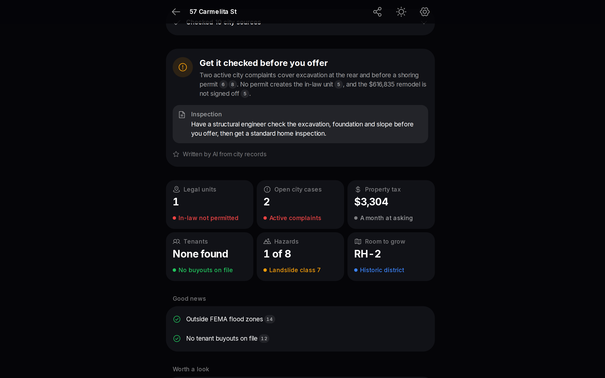
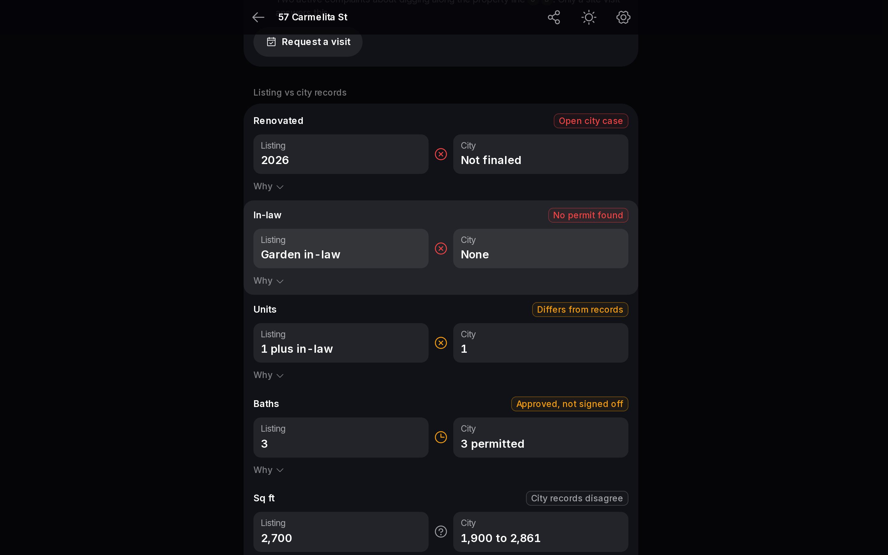
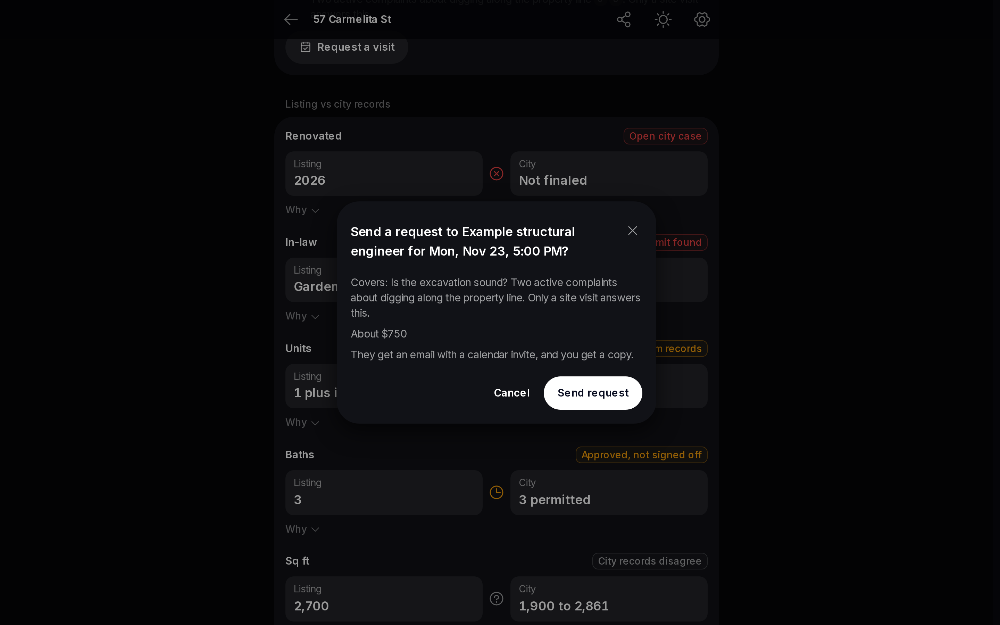
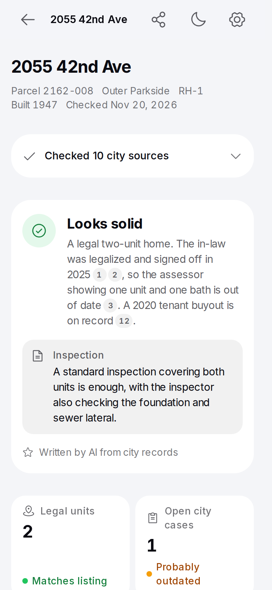

# House Checker

Paste a San Francisco listing. House Checker reads the city's own records for that parcel and tells you what is
really up with the house: what it legally is, what's open or unpermitted, what it will cost to own, who lives
there and what rent control means, what you're allowed to build, and what is still unknown. Then it acts on the
unknowns: it emails the listing agent the right questions, asks the city, or sends a specialist a visit request only
when no record can settle the question. Every finding links to the exact record behind it.

Built for the prompt: *a personal agent that helps someone make a purchase, uses reliable context to make
decisions, takes a meaningful action, and shows the information and steps behind what it did.*

## Start here

| | |
|---|---|
| `prototype/index.html` | Clickable visual spec. Open it in a browser and try the two example listings |
| `PLAN.md` | Product plan, user flow, architecture, demo script |
| `plans/CONTRACT.md` | How Plan A and Plan B are built in parallel without conflicts |
| `plans/PLAN-A.md` | Data, rules, the agent and the actions |
| `plans/PLAN-B.md` | The interface, to the Surf design standard |
| `src/contract/` | The shared types, labels, money formulas, copy checks, mock stream and golden fixture |
| `research/` | Data feasibility, prevalence numbers, market and legal context, competitors, buyer needs, money, design digest |

## Key numbers (research/prevalence.md)

- 23% of non-condo residential parcels in San Francisco have had a complaint or violation for unpermitted work
  or an illegal unit; 3,303 have one open right now.
- 49% of permitted unit additions completed before 2024, and 29% of permitted bathroom additions, never reached
  the assessor's roll.
- 11% of 2023 to 2025 sales had a prior unpermitted-work complaint.

## Run

```
npm install
cp .env.example .env.local     # every value is optional
npm run build && npm run start # http://localhost:3000  (or: npm run dev)
npm run typecheck && npm test  # 54 tests, offline (recorded city data)
node scripts/demo-check.mjs    # headless demo against a running server
```

Requirements: Node 24, and the Claude Code CLI logged in on this machine (`claude`). There is no Anthropic API
key: the server spawns `claude -p --output-format json --json-schema ...` for listing parsing, permit reading and
the short answer, and falls back to rule-written sentences when the CLI is missing or fails.

## Environment

| Variable | Default | What it does |
|---|---|---|
| `NEXT_PUBLIC_MOCK` | `0` | `1` replays the two golden fixtures in the UI with no server calls |
| `CLAUDE_BIN` | `claude` | Path to the Claude Code CLI |
| `HC_LLM` | `on` | `off` skips the CLI entirely (template sentences, regex parsing) |
| `HC_DEMO_RECORDINGS` | `0` | `1` serves recorded DataSF responses for the 6 demo addresses first (fast, works offline) |
| `HC_FETCH_TIMEOUT_MS` | `10000` | Per-request timeout for city data; one retry; stale cache beats a failure |
| `RESEND_API_KEY`, `RESEND_FROM` | unset | Send real email through Resend. Unset: emails are written to `.data/outbox/*.json` and the app says "Saved to outbox (demo)" |
| `BUYER_EMAIL`, `SPECIALIST_EMAIL` | unset, `specialist@example.com` | Copy and reply-to for the buyer; where specialist requests (with an `.ics` invite) go |
| `SENSO_API_KEY`, `SENSO_BASE_URL` | unset | Sponsor: push each report's sources and action log to Senso's context layer |
| `NEXT_PUBLIC_AMPLITUDE_API_KEY` | unset | Sponsor: product events from the UI, no addresses or text |

Data lives in `.data/` (reports, 24 h cache, outbox, idempotency keys). It is gitignored.

## Screenshots

| Verdict and tiles | Listing vs City | Specialist request | Phone |
|---|---|---|---|
|  |  |  |  |

Demo video: [submission/demo.mp4](submission/demo.mp4) (2:18). Submission answers: [submission/SUBMISSION.md](submission/SUBMISSION.md).

## Live demo

1. `npm run build && npm run start` with `.env.local` holding `NEXT_PUBLIC_MOCK=0` and `HC_DEMO_RECORDINGS=1`
   (recorded city data for the 6 demo addresses, so DataSF latency can't stall the demo).
2. Open http://localhost:3000, tap **Try 57 Carmelita St**, then **Check this home**. Walk the verdict, the
   tiles, **Request a visit** (pick a time, Continue, **Send request**) and **Email the listing agent** (type
   any address, Send, watch the 5 s Undo). Scroll to **What you sent**.
3. Back, **Try 2055 42nd Ave**: "Looks solid", the assessor is behind the permits. Tap a citation number to
   open the source sheet and **Open the record**.
4. Emails land in `.data/outbox/` unless `RESEND_API_KEY` and `RESEND_FROM` are set. The script is in
   `submission/demo-script.md`; `node scripts/demo-check.mjs` runs the same flow headless.

## Status (Nov 20, 2026, final)

- Works end to end in real mode: paste a listing, live steps from 20+ DataSF sources, the visual report, email
  the listing agent or the city (5 s Undo, idempotent), request a structural engineer (confirm dialog, request
  email with an `.ics` invite), action log restored on refresh, share link, display settings (theme, text
  size, reduced motion).
- Demo addresses: 2055 42nd Ave and 57 Carmelita St (golden fixtures; labels and source ids match the live
  pipeline), 1665 North Point St, 998 Burnett Ave, 63 Jules Ave, 686 Colby St. All stream to `done` in about
  15 to 22 s. Any other SF address runs live against DataSF; very large condo buildings take longer.
- Demo mode: without Resend keys, emails land in `.data/outbox/`. The specialist is a placeholder address.
  Senso and Amplitude are wired but off without keys.
- Not done: Gmail sending, lot lineage for pre-split permits, rich rendering of disclosure-packet findings.

## Not advice

House Checker compares a listing's claims with public City records and flags differences for you and your agent
to investigate. It is not an inspection, appraisal or legal advice. Records can be incomplete, and unpermitted
work may not appear in any record.
